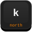

<!-- Generated by scripts/build.py from templates/README.md and profile.toml. Edit those, not this file. -->

  

  

  
  
  
  
  

  click a key, then <b>Create</b>: the focus moves for everyone in ~30s 
  no GitHub account? press anonymously: <a href="https://hjkl.dylanpict.workers.dev/gg"><b>gg</b></a> · <a href="https://hjkl.dylanpict.workers.dev/h"><b>h</b></a> · <a href="https://hjkl.dylanpict.workers.dev/j"><b>j</b></a> · <a href="https://hjkl.dylanpict.workers.dev/k"><b>k</b></a> · <a href="https://hjkl.dylanpict.workers.dev/l"><b>l</b></a> 
  <b>5</b> presses so far · last <code>h</code>

 

  <b>Dylan Zhang</b> · probably editing a dotfile right now 
  made <a href="https://github.com/Fjx-dylanZ/native-space-kit">native-space-kit</a> · <a href="https://github.com/Fjx-dylanZ/obsidian-drawer-explorer">obsidian-drawer-explorer</a> · <a href="https://github.com/Fjx-dylanZ/omp-subagent-entropy">omp-subagent-entropy</a> · <a href="https://github.com/Fjx-dylanZ/appletv-remote-tui">appletv-remote-tui</a> · patches to <a href="https://github.com/karinushka/paneru">paneru</a>

  

rebuilt daily by GitHub Actions · colors: Ghostty Citruszest + my JankyBorders config · data from 2026-10-14

